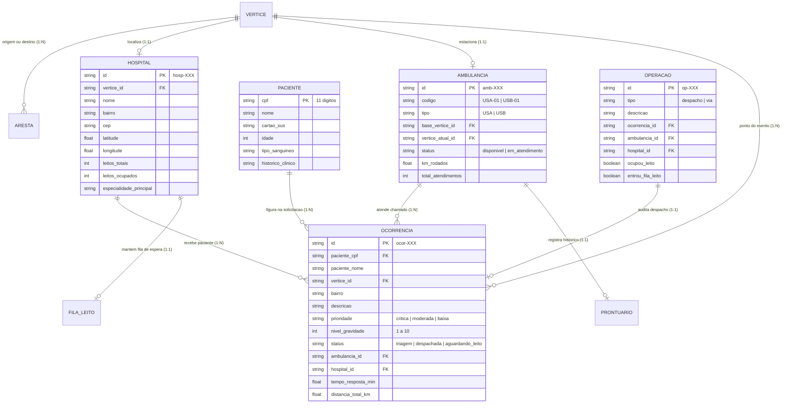

# Modelagem de Dados e Arquitetura de Estruturas — PULSO 192

Documento de modelagem conceitual, Diagrama Entidade-Relacionamento (DER), arquitetura de índices em memória e fundamentação teórica para as estruturas de dados e algoritmos exigidos na 2ª Unidade (UP2).

---

## 1. Contexto e Persistência em Memória

Seguindo as diretrizes pedagógicas da disciplina, o sistema **não emprega SGBD relacional nem bibliotecas de coleções prontas** (`list.append/pop` como caixa-preta, `collections.deque` ou `dict` para lógica central).

Toda a persistência e orquestração residem no motor de dados central ([`Store`](file:///c:/Dev/exercicio/EXERC%C3%8DCIOS%20VITAL/python/Trabalho%20UP2/backend/repository/store.py)), implementado com exclusão mútua (`threading.Lock`) para segurança em concorrência.

---

## 2. Diagrama Entidade-Relacionamento (DER)

---

## 3. Fundamentação Teórica das Estruturas da 1ª Unidade

### 3.1. Vetor Dinâmico com Redimensionamento Geométrico ([`Vetor`](file:///c:/Dev/exercicio/EXERC%C3%8DCIOS%20VITAL/python/Trabalho%20UP2/backend/estruturas/vetor.py))
- **Onde é usado:** `Store.hospitais` e `Store.ambulancias`.
- **Mecânica:** bloco contíguo de capacidade fixa com duplicação de tamanho ($2 \times$) ao atingir o limite.
- **Complexidade:** Inserção amortizada $O(1)$; acesso posicional por índice $O(1)$; iteração com máxima localidade de cache.
- **Justificativa no domínio:** hospitais e bases de socorro são coleções fixas ou de baixíssima frequência de exclusão; a operação dominante é iteração contígua e leitura por posição.

### 3.2. Lista Encadeada Simples ([`ListaEncadeada`](file:///c:/Dev/exercicio/EXERC%C3%8DCIOS%20VITAL/python/Trabalho%20UP2/backend/estruturas/lista_encadeada.py))
- **Onde é usado:** 
  1. Prontuário de atendimentos da viatura no turno (`Store.prontuario_por_ambulancia`);
  2. Lista de adjacência de cada nó no grafo viário;
  3. Baldes de tratamento de colisão na Tabela Hash por encadeamento separado.
- **Mecânica:** nós dinâmicos desacoplados com ponteiro `proximo`.
- **Complexidade:** Inserção no início ou fim $O(1)$; remoção de nó referenciado $O(1)$ sem realocação de buffers; sem custo de deslocamento de blocos de memória contígua ($O(N)$ em vetores).

### 3.3. Pilha LIFO ([`Pilha`](file:///c:/Dev/exercicio/EXERC%C3%8DCIOS%20VITAL/python/Trabalho%20UP2/backend/estruturas/pilha.py))
- **Onde é usado:** Histórico transacional de operações (`Store.historico_operacoes`).
- **Mecânica:** inserção e remoção estritamente pelo ponteiro de topo (`empilhar` e `desempilhar`).
- **Complexidade:** $O(1)$ em tempo e $O(N)$ em memória estritamente necessária.
- **Justificativa no domínio:** a operação "Desfazer" exige semântica de reversão cronológica inversa (Rollback LIFO). Ao desempilhar, o sistema desfaz o despacho restaurando a viatura à base de origem, reabrindo a vaga no hospital e reinserindo a ocorrência no Deque de triagem.

### 3.4. Fila FIFO ([`Fila`](file:///c:/Dev/exercicio/EXERC%C3%8DCIOS%20VITAL/python/Trabalho%20UP2/backend/estruturas/fila.py))
- **Onde é usado:** Fila de espera por leito de cada hospital (`Store.filas_espera_hospital`).
- **Mecânica:** lista encadeada com dois ponteiros independentes: `inicio` (cabeça para saída) e `fim` (cauda para entrada).
- **Complexidade:** `enfileirar` e `desenfileirar` ambos em $O(1)$ real.
- **Justificativa no domínio:** regulação médica exige justiça cronológica (Fair Scheduling / First-In, First-Out). Pacientes que aguardam vaga em UTI/trauma são atendidos rigorosamente pela ordem de solicitação, impedindo inanição (*starvation*).

### 3.5. Deque (Lista Linear Restrita Duplamente Terminada) ([`Deque`](file:///c:/Dev/exercicio/EXERC%C3%8DCIOS%20VITAL/python/Trabalho%20UP2/backend/estruturas/deque.py))
- **Onde é usado:** Central de Triagem 192 (`Store.deque_triagem`).
- **Mecânica:** nós duplamente encadeados com ponteiros `anterior` e `proximo`, mantendo referências `inicio` e `fim`.
- **Complexidade:** `inserir_inicio`, `inserir_fim`, `remover_inicio` e `remover_fim` todos em $O(1)$.
- **Justificativa no domínio:** na triagem do SAMU, casos de código vermelho (gravidade 8 a 10) furam a fila comum entrando pela frente do Deque em $O(1)$ para atendimento imediato; casos moderados e leves entram no fim da fila em $O(1)$.

---

## 4. Diferencial 1 — Fundamentação Matemática das Tabelas Hash

O projeto implementa uma [`TabelaHash`](file:///c:/Dev/exercicio/EXERC%C3%8DCIOS%20VITAL/python/Trabalho%20UP2/backend/estruturas/tabela_hash.py) genérica parametrizável com 3 funções de espalhamento e 2 famílias de tratamento de colisão, cada qual alocada a uma entidade do sistema de acordo com sua necessidade:

```mermaid
flowchart TD
    subgraph Hash1["1. Prontuário de Pacientes"]
        C1["Chave: CPF (11 dígitos numéricos)"]
        F1["Função: Polinômio de Horner + Módulo Primo"]
        COL1["Colisão: Encadeamento Separado (ListaEncadeada)"]
        J1["Justificativa: Evita colisão entre anagramas de dígitos e suporta surtos de vítimas sem degradação O(1)"]
        C1 --> F1 --> COL1 --> J1
    end

    subgraph Hash2["2. Cache Geográfico de Rotas"]
        C2["Chave: 'origem->destino' (composta, comprimento fixo)"]
        F2["Função: Método da Multiplicação de Knuth (Razão Áurea)"]
        COL2["Colisão: Endereçamento Aberto com Sondagem Quadrática"]
        J2["Justificativa: Elimina agrupamento primário e garante contiguidade em memória (cache de CPU)"]
        C2 --> F2 --> COL2 --> J2
    end

    subgraph Hash3["3. Diretório de Hospitais por CEP"]
        C3["Chave: CEP (8 dígitos com prefixo fixo 570xx)"]
        F3["Função: Método da Dobra / Enlaçamento (blocos de 3 dígitos)"]
        COL3["Colisão: Endereçamento Aberto com Sondagem Linear"]
        J3["Justificativa: Prefixos regionais idênticos são dobrados sobre o sufixo garantindo dispersão uniforme"]
        C3 --> F3 --> COL3 --> J3
    end
```

### 4.1. Tabela 1: Pacientes por CPF (`hash_pacientes_cpf`)
- **Função Hash:** Polinômio de Horner com base prima 31 e redução por módulo primo $M$:
  $$h(k) = \left( \sum_{i=0}^{n-1} c_i \cdot 31^{n-1-i} \right) \bmod M$$
- **Tratamento de Colisão:** Encadeamento Separado com `ListaEncadeada`.
- **Por que usamos no domínio:** 
  CPFs possuem padrões repetitivos decorrentes da numeração regional (o 9º dígito em Alagoas é sempre 4). O método da divisão simples geraria colisões em cascata para CPFs com dígitos permutados. Horner trata a string como coeficientes polinomiais posicionais, dispersando anagramas. O encadeamento separado garante que mesmo durante um desastre com centenas de atendimentos simultâneos, o tempo de busca continue $O(1 + \alpha)$ sem risco de saturação da tabela.

### 4.2. Tabela 2: Cache de Rotas Viárias (`hash_cache_rotas`)
- **Função Hash:** Método da Multiplicação de Donald Knuth:
  $$h(k) = \lfloor M \cdot ((k \cdot A) \bmod 1) \rfloor \quad \text{onde } A = \frac{\sqrt{5} - 1}{2} \approx 0.6180339887$$
- **Tratamento de Colisão:** Endereçamento Aberto com Sondagem Quadrática:
  $$h(k, i) = (h(k) + c_1 \cdot i + c_2 \cdot i^2) \bmod M \quad (c_1=1, c_2=1)$$
- **Por que usamos no domínio:** 
  As rotas viárias possuem chaves padronizadas (ex.: `v-samu-farol->v-hge`). Todas as rotas que partem da mesma base compartilham o mesmo prefixo. A constante áurea de Knuth extrai bits pseudo-aleatórios da parte fracionária, espalhando uniformemente chaves correlacionadas. A sondagem quadrática evita o agrupamento primário da sondagem linear e mantém todas as rotas contíguas no vetor, maximizando o aproveitamento do cache L1/L2 do processador.

### 4.3. Tabela 3: Unidades de Saúde por CEP (`hash_unidades_cep`)
- **Função Hash:** Método da Dobra / Enlaçamento (*Boundary Folding*):
  A chave é particionada em blocos de 3 dígitos; blocos ímpares são invertidos e somados:
  $$S = d_1 d_2 d_3 + \text{inv}(d_4 d_5 d_6) + d_7 d_8 \implies h(k) = S \bmod M$$
- **Tratamento de Colisão:** Endereçamento Aberto com Sondagem Linear ($h(k, i) = (h(k) + i) \bmod M$).
- **Por que usamos no domínio:** 
  Em Maceió, quase todos os CEPs iniciam com `570`. A função da dobra mistura o prefixo estático com o miolo e o sufixo terminal do logradouro, garantindo que todos os dígitos do CEP afetem o índice resultante.

### 4.4. Tabela 4 (Extensão de Segurança): Hash Criptográfico Avançado (HMAC-SHA256 + LGPD)
- **Função Hash:** HMAC-SHA256 com segredo simétrico de 256 bits:
  $$\text{HMAC}(K, m) = \text{SHA256}\left((K \oplus \text{opad}) \parallel \text{SHA256}((K \oplus \text{ipad}) \parallel m)\right)$$
- **Aplicações Críticas no Sistema:**
  1. **Pseudonimização LGPD dos Pacientes:** os 11 dígitos do CPF geram um token irreversível de 16 caracteres hexadecimais para tráfego seguro entre o SAMU e os hospitais (Art. 13 da LGPD — tratamento de dados sensíveis de saúde).
  2. **Assinatura Digital Inviolável de Despachos:** cada ocorrência despachada recebe um carimbo digital em SHA-256 gerado a partir do `ID da ocorrência + Código da Ambulância + Hospital + Timestamp`, impedindo adulteração forense de ordens de serviço.
- **Comprovação do Efeito Avalanche (Difusão de Shannon):**
  Uma função hash criptográfica avançada difere das funções comuns por possuir alta difusão: a troca de um único caractere no CPF (ex.: de `111.222.333-44` para `111.222.333-45`) altera em média 50% dos 256 bits do hash resultante, impedindo correlações estatísticas ou ataques de colisão dirigida. O sistema inclui um simulador ao vivo que calcula a distância de Hamming bit a bit e a taxa percentual de variação.

---

## 5. Diferencial 2 — Grafo Viário e Algoritmos de Roteirização

A malha urbana foi modelada como um grafo valorizado e não-direcionado $G = (V, E)$, onde $V$ representa 24 vértices geográficos e $E$ representa 39 corredores viários.

### 5.1. Ponderação das Arestas
A distância base $d$ é calculada via fórmula do Semiverseno (Haversine):
$$a = \sin^2\left(\frac{\Delta \phi}{2}\right) + \cos(\phi_1)\cos(\phi_2)\sin^2\left(\frac{\Delta \lambda}{2}\right)$$
$$d = 2 \cdot R \cdot \text{atan2}(\sqrt{a}, \sqrt{1-a}) \quad (R = 6371 \text{ km})$$
O tempo de deslocamento em minutos é obtido considerando o trânsito da via:
$$t = \frac{d \cdot 1.22}{\max\left(5.0, \frac{v_{\text{media}}}{\text{fator\_transito}}\right)} \times 60$$

### 5.2. Algoritmos Implementados
1. **Dijkstra:** calcula o trajeto ótimo em minutos entre a viatura, a vítima e o hospital com leito livre, visitando os vértices em ordem de custo acumulado com complexidade $O(|V|^2)$ no pior caso.
2. **Árvore Geradora Mínima (Algoritmo de Prim):** seleciona um subconjunto acíclico de arestas que conecta todos os 24 bairros e hospitais com o menor tempo total acumulado, definindo os corredores viários estratégicos de Maceió.
3. **Busca em Largura (BFS):** encontra todas as unidades de socorro a até $k$ saltos na malha urbana, útil para despacho em cascata.
4. **Busca em Profundidade (DFS):** diagnostica instantaneamente se alagamentos ou bloqueios romperam a conectividade do grafo, identificando bairros isolados.

---

## 6. Diferencial 3 — Comparativo Experimental de Ordenação

Implementados no módulo [`ordenacao.py`](file:///c:/Dev/exercicio/EXERC%C3%8DCIOS%20VITAL/python/Trabalho%20UP2/backend/estruturas/ordenacao.py):

| Algoritmo | Melhor Caso | Caso Médio | Pior Caso | Estabilidade | Memória Extra |
|---|---|---|---|---|---|
| **Método da Bolha (Bubble)** | $O(N)$ (com flag de troca) | $O(N^2)$ | $O(N^2)$ | Estável | $O(1)$ |
| **Método da Inserção (Insertion)** | $O(N)$ | $O(N^2)$ | $O(N^2)$ | Estável | $O(1)$ |
| **Método da Seleção (Selection)** | $O(N^2)$ | $O(N^2)$ | $O(N^2)$ | Instável | $O(1)$ |
| **QuickSort (Mediana de Três)** | $O(N \log N)$ | $O(N \log N)$ | $O(N^2)$ | Instável | $O(\log N)$ |

A aplicação instrumenta o número exato de comparações, trocas/deslocamentos e o tempo de relógio em milissegundos para qualquer tamanho de entrada $N$, exibindo os dados em tabela e gráfico de barras no Matplotlib.

